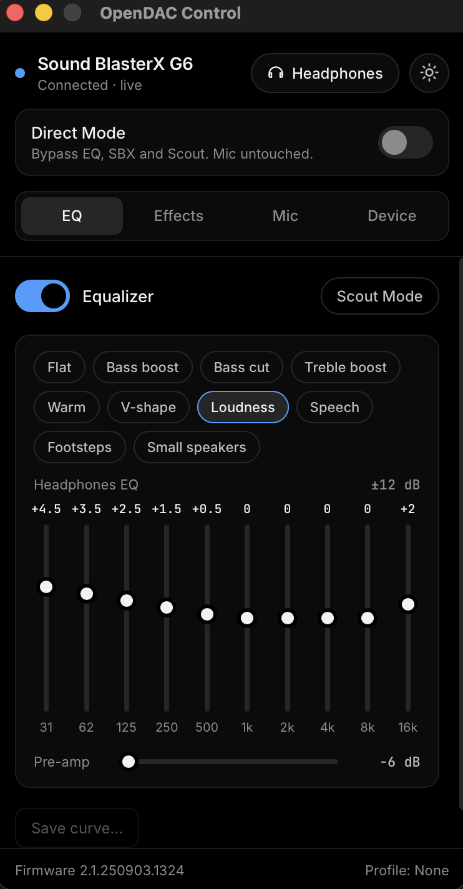
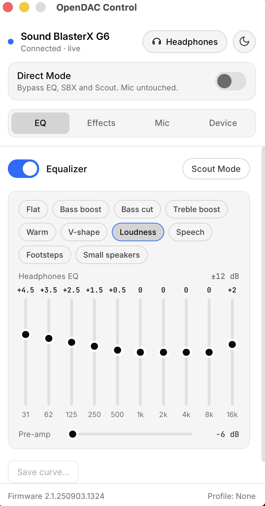
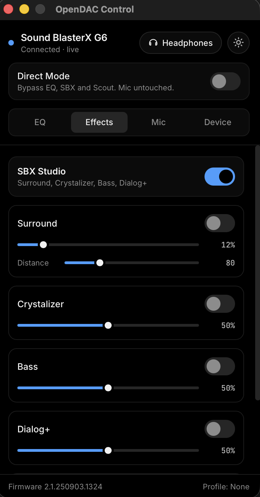
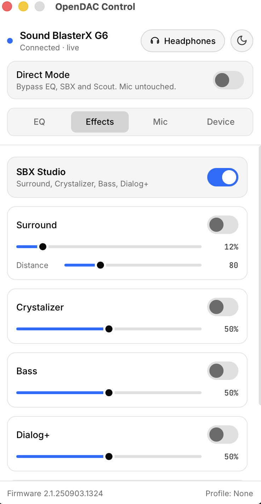

# OpenDAC Control

An open-source control app for the **Creative Sound BlasterX G6** USB DAC/amp, replacing Creative's Sound Blaster Command. It runs on macOS now, with Windows planned. It talks to the G6 directly over USB HID; no Creative software or drivers are needed.

It has two parts:

- **OpenDAC Control**: a desktop app (Tauri 2 + Svelte) with a pitch-black window, a Dock icon and a menu bar icon.
- **`g6`**: a command-line tool for scripting and testing.

Both use the same Rust library, `g6-core`.

## Screenshots

| | Dark | Light |
|---|---|---|
| **EQ** |  |  |
| **Effects** |  |  |

## Features

- **EQ:** 10-band equalizer (31 Hz to 16 kHz, ±12 dB in 0.5 dB steps), pre-amp (±6 dB in 0.5 dB steps), on/off. The app has built-in curves (Flat, Bass boost, Bass cut, Treble boost, Warm, V-shape, Loudness, Speech, Footsteps, Small speakers) with pre-amp values sized to avoid clipping (rationale: `reports/G6 ten band EQ presets.md`), and lets you save your own named EQ curves (bands and pre-amp).
- **SBX effects:** Surround (level and distance), Crystalizer, Bass, Dialog+ and Smart Volume (level and Normal / Loud / Night mode), plus the SBX master switch.
- **Scout Mode:** shown with the device's Scout EQ curve. The EQ bands and curve chips are locked while Scout is on; the pre-amp stays adjustable (Scout doesn't change it).
- **Mic:** boost (0 / 10 / 20 / 30 dB), Voice Clarity with noise-reduction level, mic EQ on/off, echo cancellation, recording Smart Volume.
- **Device:** DAC filter (fast or slow roll-off, minimum or linear phase, NOS), Dolby Digital decoder mode for the optical input (Full / Normal / Night).
- **Direct Mode:** turns SBX, Scout and EQ off and restores them when switched off. Mic settings are left alone. The saved state is written to disk first, so a crash doesn't lose it.
- **Per-output settings:** headphones and speakers each keep their own EQ, pre-amp, effects and mic settings. The G6 switches between them automatically when headphones are plugged in.
- **Live sync:** the SBX and Scout buttons, the headphone jack and USB replugs show up immediately, without polling. After a replug, your last settings are put back.
- **Profiles** (called presets in the CLI and on disk): save, apply, rename and delete named profiles. A profile holds all playback settings (EQ, pre-amp, SBX, Scout, effects) and applies to the active output. EQ curves (the chips on the EQ tab) hold only the EQ bands and pre-amp.

- **Theme:** pitch black (default) or pure white, switched with the sun / moon button in the app's header; the choice is remembered.

The volume knob, mute and the hardware gain switch are left to the G6 and the operating system.

## Install

### macOS

1. Build the app (see [Build from source](#build-from-source)) or get a release build. The build produces:
   - `target/release/bundle/macos/OpenDAC Control.app`
   - `target/release/bundle/dmg/OpenDAC Control_<version>_aarch64.dmg`
2. Copy **OpenDAC Control.app** to `/Applications`, or open the `.dmg` and drag the app there.
3. **First launch:** the app is not signed with an Apple Developer ID, so macOS blocks it the first time. In Finder, right-click the app, choose **Open**, then **Open** again. After that it opens normally from Launchpad, Spotlight or Finder.
4. If macOS asks for **Input Monitoring** permission, allow it; the app needs it to talk to the G6 over USB.

Using the app:

- **Opening:** it opens a window and shows a Dock icon. A ◎ icon also appears in the menu bar; left-click it to show the window, right-click it for **Quit**.
- **Closing:** closing the window keeps the app running, so live sync and restoring settings after a replug keep working. Click the Dock icon to bring the window back.
- **Quitting:** use **Quit OpenDAC Control** (⌘Q) from the app menu or the menu bar icon.
- **Notch:** on a MacBook with a notch and a full menu bar, the ◎ icon can be hidden behind the notch. Use the Dock icon instead.
- **Launch at login:** off by default. Turn it on in the app's **Device** tab.

### Automated builds

`.github/workflows/build.yml` builds the macOS (Apple Silicon `.dmg`) and Windows (`.exe` installer, `.msi`, and a portable `.exe`) versions on GitHub Actions. It runs when a version tag is pushed (`git tag v0.1.0 && git push origin v0.1.0`), attaching the files to a draft GitHub release, or by hand from the Actions tab (files appear under the run's artifacts for 14 days).

### Windows (planned, milestone M3)

The Windows build will produce a standalone `.exe` that you can copy to the Desktop or any folder, plus an installer (MSI / NSIS). It needs Microsoft Edge WebView2, which Windows 11 includes. Because the build is unsigned, SmartScreen warns on first run; choose **More info**, then **Run anyway**.

## Command-line tool (`g6`)

```sh
cargo run -p g6-cli -- <command>     # or: cargo build --release -p g6-cli; ./target/release/g6
```

| Command | What it does |
|---|---|
| `g6 info` | Firmware version and hardware ids |
| `g6 status [--json]` | Full state: both output profiles, mic, filter, decoder |
| `g6 watch` | Stream changes from the device (buttons, jack, replug); Ctrl-C to stop |
| `g6 eq on\|off` | EQ on or off |
| `g6 eq set 31=3 62=2 1k=-1 …` | Set band gains in dB (0.5 steps, ±12) |
| `g6 eq preamp <dB>` | Set the EQ pre-amp in dB (0.5 steps, ±6) |
| `g6 sbx on\|off` / `g6 scout on\|off` | SBX / Scout Mode |
| `g6 surround on\|off\|<0..1> [--distance <10..300>]` | Surround; a level also switches it on |
| `g6 crystalizer\|bass\|dialog on\|off\|<0..1>` | Other SBX effects |
| `g6 smartvol on\|off\|<0..1> [--mode normal\|loud\|night]` | Smart Volume |
| `g6 dolby full\|normal\|night` | Dolby decoder mode (optical input) |
| `g6 filter fast-min\|slow-min\|nos\|fast-lin\|slow-lin` | DAC filter |
| `g6 mic boost 0\|10\|20\|30` | Mic boost |
| `g6 mic clarity on\|off` / `g6 mic nr <0..1>` | Voice Clarity and its noise-reduction level |
| `g6 mic eq on\|off` / `g6 mic aec on\|off` | Mic EQ / echo cancellation |
| `g6 direct on\|off` | Direct Mode |
| `g6 preset save\|load\|list\|delete NAME` | Profiles (the app's Profiles list) |

Use `-v` / `-vv` for more logging and `--connect-timeout <SECS>` to change the 3 s wait for the device. Exit status is `2` for bad input and `1` for device or file errors.

## Where settings are stored

| File | macOS | Windows |
|---|---|---|
| Profiles (`g6 preset`) | `~/Library/Application Support/opendac-control/presets/` | `%APPDATA%\opendac-control\config\presets\` |
| Saved EQ curves (app) | `…/opendac-control/eq_curves.json` | `%APPDATA%\opendac-control\config\eq_curves.json` |
| Last known settings (restored after a replug) | `~/Library/Application Support/opendac-control/last_known.json` | `%APPDATA%\opendac-control\data\last_known.json` |
| Direct Mode saved state | `…/opendac-control/direct_mode.json` | `%APPDATA%\opendac-control\data\direct_mode.json` |
| App settings (active profile) | `…/opendac-control/app_settings.json` | `%APPDATA%\opendac-control\config\app_settings.json` |

The Windows paths follow the `directories` crate's conventions and haven't been checked on Windows yet.

## Build from source

Requirements:

- **Rust:** a recent stable toolchain (1.88 or newer).
- **Node.js and npm:** build-time only, for the UI.
- **macOS:** Xcode Command Line Tools.
- **Windows:** the Tauri prerequisites, i.e. MSVC build tools and WebView2.

```sh
# Libraries, CLI and tests
cargo build --workspace
cargo test --workspace                                       # no device needed
cargo test -p g6-core --test hardware -- --ignored           # needs a G6 plugged in

# App: install UI dependencies once
cd app/ui && npm install

npm run dev                  # UI only, in a browser, with a simulated device
npm run tauri dev            # the app, connected to the real G6
npm run tauri build          # release bundles (.app and .dmg on macOS)
```

The hardware tests read each setting, change it, read it back and restore the original value.

## Project layout

```
crates/g6-core/     device library: USB HID transport, protocol, feature table,
                    state, events, Direct Mode, presets, session (re-apply)
crates/g6-cli/      the `g6` command-line tool
app/src-tauri/      desktop app shell (Rust, Tauri 2)
app/ui/             app UI (Svelte + TypeScript + Vite)
app/API.md          contract between the UI and the Rust side
docs/design/        UI mockups
docs/images/        screenshots used in this README
reports/            research reports (EQ preset design)
research_notes/     notes behind the reports
```

## Safety notes

- **Interface 3 is never opened.** It is the G6's volume-knob interface; opening it stops macOS from receiving the knob until a replug. The app only opens interface 4, the control interface.
- **Only known settings are written.** Every setting the app writes is listed in an allow-list with its valid range, and anything outside it is refused before it reaches the device.

## Status

- **M1, the device library and `g6` CLI:** done, verified on a G6 (firmware 2.1.250903.1324) on macOS.
- **M2, the macOS app:** built and in use on macOS with the G6; tested by hand (Scout, pre-amp, EQ curves). Not yet fully checked against the M2 list.
- **M3, Windows:** planned.

## License

MIT; see [LICENSE](LICENSE). Thanks to [linuxblaster_control](https://github.com/RizeCrime/linuxblaster_control) (MIT), whose USB protocol notes were the starting point for this project's G6 protocol work. This project is not affiliated with or endorsed by Creative Technology. Sound BlasterX and SBX are trademarks of their owner.
