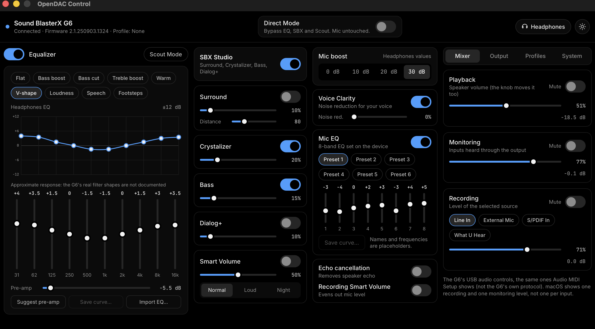
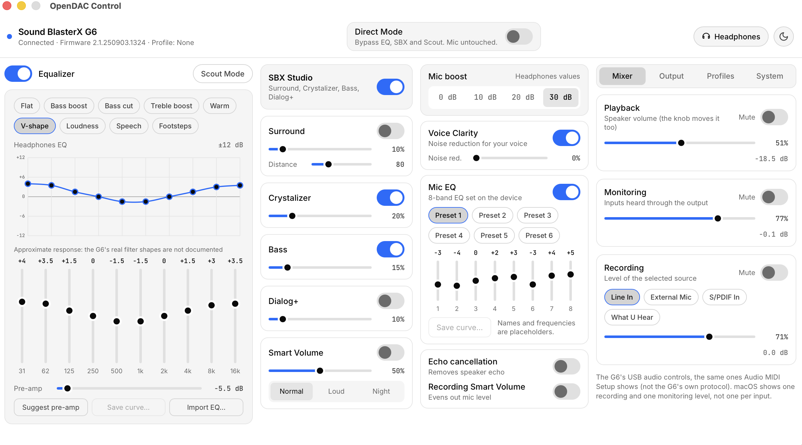

# OpenDAC Control

An open-source control app for the **Creative Sound BlasterX G6** USB DAC/amp, replacing Creative's Sound Blaster Command. It runs on macOS and Windows (the Mixer tab is macOS only). It talks to the G6 directly over USB HID; no Creative software or drivers are needed.

It has two parts:

- **OpenDAC Control**: a desktop app (Tauri 2 + Svelte) with a pitch-black window, a Dock icon and a menu bar icon.
- **`g6`**: a command-line tool for scripting and testing.

Both use the same Rust library, `g6-core`.

## Screenshots

The window is a 1280 × 720 landscape layout: EQ, Effects and Mic are always on screen, and a fourth column switches between Mixer, Output, Profiles and System.

| Dark | Light |
|---|---|
|  |  |

## Features

- **EQ:** 10-band equalizer (31 Hz to 16 kHz, ±12 dB in 0.5 dB steps), pre-amp (±6 dB in 0.5 dB steps), on/off. The app has built-in curves (Flat, Bass boost, Bass cut, Treble boost, Warm, V-shape, Loudness, Speech, Footsteps, Small speakers) with pre-amp values sized to avoid clipping (rationale: `reports/G6 ten band EQ presets.md`), and lets you save your own named EQ curves (bands and pre-amp). A response curve above the sliders (approximate: the G6's real filter shapes are not documented) shows the ten bands; drag its points to edit them, and "Suggest pre-amp" sets the pre-amp to cancel the largest boost.
- **SBX effects:** Surround (level and distance), Crystalizer, Bass, Dialog+ and Smart Volume (level and Normal / Loud / Night mode), plus the SBX master switch.
- **Scout Mode:** shown with the device's Scout EQ curve. The EQ bands and curve chips are locked while Scout is on; the pre-amp is not locked, but the G6 sets it to 0 dB when Scout turns on and restores the previous value when Scout turns off, so the app shows 0 dB while Scout is on.
- **Mic:** boost (0 / 10 / 20 / 30 dB), Voice Clarity with noise-reduction level, mic EQ on/off with 8 band sliders (labelled 1-8: the band frequencies are not known), 11 built-in mic EQ presets (`Preset 1` to `Preset 11`, from the upstream `linuxblaster_control` capture; the real names are unknown) and your own saved mic EQ curves, echo cancellation, recording Smart Volume.
- **Output tab:** DAC filter (fast or slow roll-off, minimum or linear phase, NOS), Dolby Digital decoder mode for the optical input (Full / Normal / Night).
- **About this device:** firmware, serial number, DSP version and hardware id (System tab; `g6 info` prints them too).
- **Lighting:** (System tab) the G6's LED on/off and a static colour (colour picker with swatches).
- **Output switch:** a Headphones / Speakers switch on the Output tab for when you want to override the output by hand. The G6 still switches by itself when headphones are plugged in or out.
- **Direct Mode:** turns SBX, Scout and EQ off and restores them when switched off. It also engages the G6's own Direct Mode. Mic settings are left alone. The saved state is written to disk first, so a crash doesn't lose it.
- **Per-output settings:** headphones and speakers each keep their own EQ, pre-amp, effects and mic settings. The G6 switches between them automatically when headphones are plugged in.
- **Live sync:** the SBX and Scout buttons, the headphone jack and USB replugs show up immediately, without polling. After a replug, your last settings are put back.
- **Profiles** (called presets in the CLI and on disk): save, apply, rename and delete named profiles. A profile holds all playback settings (EQ, pre-amp, SBX, Scout, effects) and applies to the active output. EQ curves (the chips on the EQ tab) hold only the EQ bands and pre-amp.
- **Import / export:** export a profile to a `.json` file (Export button on its row, native Save dialog) and import one back (Import profile…); a file is checked against the feature table before it is saved, and an existing profile is never replaced. "Import EQ…" on the EQ tab loads an AutoEq / Equalizer APO text (`Preamp:`, `Filter N: ON PK|LSC|HSC Fc .. Gain .. Q ..`, `GraphicEQ:`) onto the ten bands and pre-amp: filters are evaluated at the band centres (approximate, the G6's own filter shapes are not documented), rounded to 0.5 dB and clamped to ±12 dB (pre-amp ±6 dB), and the notes say what was clamped or ignored.
- **Auto-switch profiles:** in the Profiles section, pick a profile to apply when the output becomes headphones and/or speakers (the headphone jack). A rule fires only on an output change, not at startup, and is skipped while Direct Mode is on. Switching the output by hand in the app does not fire it.
- **Tray menu:** right-click the menu bar / tray icon for Show window, Direct Mode, SBX, Scout Mode and Lighting (check marks show the current state), an Output submenu (Headphones / Speakers) and a Profiles submenu (apply). Items grey out while the G6 is not connected; SBX, Scout and Profiles also while Direct Mode is on. The menu follows the device live.
- **Global hotkeys:** optional, off by default (System tab, **Global shortcuts**): toggle Direct Mode, apply the next profile, toggle SBX. Click a field and press the keys; each needs Ctrl, Alt or Cmd / Win. Suggested keys: Ctrl+Alt+Cmd+D / P / S on macOS, Ctrl+Alt+Shift+D / P / S on Windows. A shortcut another app already holds is reported under its row, and the others still work.

- **Mixer (macOS):** a Mixer tab in the fourth column with the G6's USB audio controls as CoreAudio offers them: playback volume and mute, monitoring volume and mute, recording volume and mute, and the recording source (Line In / External Mic / S/PDIF In / What U Hear). They are not HID, so the app uses CoreAudio, only on macOS; elsewhere the tab is hidden. macOS shows one monitoring and one recording level, not one per input. Changes made elsewhere (the volume knob, System Settings) show up without polling.
- **Theme:** pitch black (default) or pure white, switched with the sun / moon button in the app's header; the choice is remembered.

The volume knob and the hardware gain switch are left to the G6 and the operating system (on macOS the Mixer tab shows the volume the knob moves).

## Install

### macOS

1. Build the app (see [Build from source](#build-from-source)) or get a release build. The build produces:
   - `target/release/bundle/macos/OpenDAC Control.app`
   - `target/release/bundle/dmg/OpenDAC Control_<version>_aarch64.dmg`
2. Copy **OpenDAC Control.app** to `/Applications`, or open the `.dmg` and drag the app there.
3. **First launch:** the app is not signed with an Apple Developer ID, so macOS blocks it the first time. In Finder, right-click the app, choose **Open**, then **Open** again. After that it opens normally from Launchpad, Spotlight or Finder.
4. If macOS asks for **Input Monitoring** permission, allow it; the app needs it to talk to the G6 over USB.

Using the app:

- **Opening:** it opens a window and shows a Dock icon. A ◎ icon also appears in the menu bar; left-click it to show the window, right-click it for the tray menu (Direct Mode, SBX, Scout, Output, Lighting, Profiles, **Quit**).
- **Closing:** closing the window keeps the app running, so live sync and restoring settings after a replug keep working. Click the Dock icon to bring the window back.
- **Quitting:** use **Quit OpenDAC Control** (⌘Q) from the app menu or the menu bar icon.
- **Notch:** on a MacBook with a notch and a full menu bar, the ◎ icon can be hidden behind the notch. Use the Dock icon instead.
- **Launch at login:** off by default. Turn it on in the app's **System** tab.

### Automated builds

`.github/workflows/build.yml` first runs the checks and tests on macOS and Windows, then builds the macOS (Apple Silicon `.dmg`) and Windows (`.exe` installer, `.msi`, and a portable `.exe`) versions on GitHub Actions. It runs when a version tag is pushed (`git tag v0.1.0 && git push origin v0.1.0`), attaching the files to a draft GitHub release, or by hand from the Actions tab (files appear under the run's artifacts for 14 days).

### Windows

The Windows build (from the GitHub Actions workflow above) produces a standalone `OpenDAC-Control-portable.exe` that you can copy to the Desktop or any folder, plus an installer (NSIS `.exe` and `.msi`). It needs Microsoft Edge WebView2, which Windows 11 includes. Because the build is unsigned, SmartScreen warns on first run; choose **More info**, then **Run anyway**.

## Command-line tool (`g6`)

```sh
cargo run -p g6-cli -- <command>     # or: cargo build --release -p g6-cli; ./target/release/g6
```

| Command | What it does |
|---|---|
| `g6 info` | Firmware version, serial number and hardware ids |
| `g6 status [--json]` | Full state: both output profiles, mic, filter, decoder |
| `g6 watch [--json]` | Stream changes from the device (buttons, jack, replug); Ctrl-C to stop. `--json` prints one JSON object per line |
| `g6 eq on\|off` | EQ on or off |
| `g6 eq set 31=3 62=2 1k=-1 …` | Set band gains in dB (0.5 steps, ±12) |
| `g6 eq preamp <dB>` | Set the EQ pre-amp in dB (0.5 steps, ±6) |
| `g6 sbx on\|off` / `g6 scout on\|off` | SBX / Scout Mode |
| `g6 surround on\|off\|<0..1> [--distance <10..300>]` | Surround; a level also switches it on |
| `g6 crystalizer\|bass\|dialog on\|off\|<0..1>` | Other SBX effects |
| `g6 smartvol on\|off\|<0..1> [--mode normal\|loud\|night]` | Smart Volume |
| `g6 dolby full\|normal\|night` | Dolby decoder mode (optical input) |
| `g6 filter fast-min\|slow-min\|nos\|fast-lin\|slow-lin` | DAC filter |
| `g6 mic boost 0\|10\|20\|30` | Mic boost |
| `g6 mic clarity on\|off` / `g6 mic nr <0..1>` | Voice Clarity and its noise-reduction level |
| `g6 mic eq on\|off` / `g6 mic aec on\|off` | Mic EQ / echo cancellation |
| `g6 direct on\|off` | Direct Mode |
| `g6 light on\|off` | LED lighting on or off |
| `g6 light color RRGGBB` | LED colour (hex) |
| `g6 output headphones\|speakers` | Switch the output by hand (the jack still switches it on plug / unplug) |
| `g6 preset save\|load\|list\|delete NAME` | Profiles (the app's Profiles list) |
| `g6 preset export NAME FILE` / `g6 preset import FILE [--name NAME]` | Write a profile to a JSON file (overwrites FILE) / save one from a file after checking every value (name defaults to the file name; an existing profile is not replaced). No device needed |
| `g6 eq import FILE` | Set the bands and pre-amp from an AutoEq / Equalizer APO text file; clamped or approximated values are listed on stderr. Does not change whether the EQ is on |
| `g6 serve [--port <PORT>]` | Local HTTP API on 127.0.0.1 (default port 8765) for Stream Deck, Home Assistant and scripts; see [Local API](#local-api) |

Use `-v` / `-vv` for more logging and `--connect-timeout <SECS>` to change the 3 s wait for the device. Exit status is `2` for bad input and `1` for device or file errors. While Direct Mode is on, commands that change playback settings (SBX, Scout, EQ, effects, `eq import`, `preset save` / `load`) are refused, as in the app; mic, decoder, filter, light and output commands still work. While Scout Mode is on, commands that write the EQ bands, the EQ on / off switch or Smart Volume (`eq on|off`, `eq set`, `eq import`, `smartvol`) fail with "Scout Mode is on: EQ and Smart Volume are set by the device"; the pre-amp is not locked.

### `g6 watch --json`

One JSON object per line, only for changes (repeated device dumps are skipped). Every object has `ts` (seconds since the Unix epoch) and `event`; the other keys depend on `event`:

| `event` | Other keys |
|---|---|
| `connected`, `disconnected` | none (`connected` also follows a replug) |
| `output` | `output`: `headphones` or `speakers` |
| `feature` | `name` (feature name, as in `g6 status --json`), `value` (same scale as `status --json`: on/off is 1/0, `mic_nr_level` is 0..1), `text` (as `g6 watch` prints it, e.g. `-1.5 dB`, `night`) |
| `mask` | `sbx`, `scout`, `voice_clarity` (booleans) |
| `filter` | `filter`: DAC filter name |
| `mic_boost` | `db`: 0, 10, 20 or 30 |
| `light` | `on` (boolean) |
| `light_color` | `color`: `RRGGBB` |

```
{"event":"mask","sbx":true,"scout":false,"ts":1731800000.123,"voice_clarity":false}
{"event":"output","output":"speakers","ts":1731800002.5}
```

The order of keys is not defined. New keys or events may be added later; existing ones keep their meaning.

## Local API

`g6 serve` starts an HTTP API for Stream Deck, Home Assistant or your own scripts. It is meant for the same machine only:

- It listens on `127.0.0.1` and nowhere else. Requests whose `Host` is not `127.0.0.1`, `localhost` or `[::1]` with the server's port, or whose `Origin` is not a loopback page, get `403` (this blocks DNS rebinding and web pages sending requests from your browser). No CORS headers are sent, so browsers cannot read the answers anyway.
- Every request needs `Authorization: Bearer <token>` (`401` otherwise). The token is made at first run and kept in `api_token` in the config directory (`~/Library/Application Support/opendac-control/` on macOS, `%APPDATA%\opendac-control\config\` on Windows, `~/.config/opendac-control/` on Linux), readable by you only (mode `0600`; Windows uses the profile folder's access rules). If the file can be read by other users, `g6 serve` refuses to start, since the token may be known to them. `g6 serve` prints the file's path, never the token. Delete the file to get a new token.
- A local process without the token cannot change settings, and what it can tie up is bounded. The server speaks HTTP itself (one request per connection) and limits everything before any check runs, so slots always come back (such a process can still fill them for a few seconds at a time): at most 32 connections at once (more get `503` without being read) and 8 event streams, request heads up to 8 KiB (`431`) and bodies up to 4 KiB (`413`), 10 seconds to send a whole request (`408`, so a client that sends nothing or one byte at a time is dropped), and 10 seconds for every write to the client, event streams included. An event-stream client that closes its connection is noticed within about a second and frees its slot. One that stays connected but stops reading is dropped only once its socket buffers are full, which takes a while on a quiet device (a ping every 15 seconds, and each event), so it can hold one of the 8 slots for a long time; the other limits are unaffected.
- Settings go through the same feature table and range checks as the CLI.
- While Direct Mode is on, playback writes (SBX, Scout, EQ and effects features, preset apply) are refused with `409`, as in the app. Mic and decoder features, output, light and `/v1/direct` still work. As in the app, switching the output (`/v1/output` or the headphone jack) extends Direct Mode to the new output, and after Direct Mode is turned off, an output whose settings are still saved gets them back when it becomes active.
- While Scout Mode is on, the EQ bands, the EQ on/off switch and Smart Volume (on/off and level) belong to Scout and are refused with `409`, as in the app. The pre-amp is not locked.

```sh
g6 serve &                                    # prints the port and the token file
TOKEN=$(cat "$HOME/Library/Application Support/opendac-control/api_token")
curl -H "Authorization: Bearer $TOKEN" http://127.0.0.1:8765/v1/state
curl -H "Authorization: Bearer $TOKEN" -d '{"name":"eq_1k","value":-1.5}' http://127.0.0.1:8765/v1/features
curl -H "Authorization: Bearer $TOKEN" -d '{"on":true}' http://127.0.0.1:8765/v1/sbx
curl -N -H "Authorization: Bearer $TOKEN" http://127.0.0.1:8765/v1/events
```

| Request | Body | What it does |
|---|---|---|
| `GET /v1/state` | | Same JSON as `g6 status --json`, from the live state the server keeps (the last known state, with `"connected": false`, while the G6 is unplugged). `GET /v1/state?refresh=1` re-reads the whole device first (about 70 reads), so poll without it |
| `GET /v1/events` | | Server-Sent Events: each `data:` line is one `g6 watch --json` object |
| `POST /v1/features` | `{"name": "eq_1k", "value": -1.5}` | Set one feature from the feature table. `value` is a number on the scale `g6 status --json` shows, `true`/`false` for on/off features, or a choice name (`"night"`) |
| `POST /v1/sbx`, `/v1/scout`, `/v1/direct` | `{"on": true}` | SBX, Scout Mode, Direct Mode |
| `POST /v1/output` | `{"output": "speakers"}` | Switch the output |
| `POST /v1/light` | `{"on": true, "color": "ff8000"}` | LED; give `on`, `color` or both |
| `POST /v1/preset/apply` | `{"name": "movies"}` | Apply a preset to the active output |

Writes answer `{"ok": true, ...}`; errors answer `{"error": "..."}` with `400` (bad input), `404` (unknown path or preset), `405`, `408`, `409` (for example Direct Mode off when it is not on), `413`, `431`, `500` (device or file error), `501` (a `Transfer-Encoding` other than `chunked`) or `503` (G6 not connected, or too many connections). Bodies must be JSON objects with only the fields shown.

## Where settings are stored

| File | macOS | Windows |
|---|---|---|
| Profiles (`g6 preset`) | `~/Library/Application Support/opendac-control/presets/` | `%APPDATA%\opendac-control\config\presets\` |
| Saved EQ curves (app) | `…/opendac-control/eq_curves.json` | `%APPDATA%\opendac-control\config\eq_curves.json` |
| Saved mic EQ curves (app) | `…/opendac-control/mic_eq_curves.json` | `%APPDATA%\opendac-control\config\mic_eq_curves.json` |
| Last known settings, including the LED lighting (restored after a replug) | `~/Library/Application Support/opendac-control/last_known.json` | `%APPDATA%\opendac-control\data\last_known.json` |
| Direct Mode saved state | `…/opendac-control/direct_mode.json` | `%APPDATA%\opendac-control\data\direct_mode.json` |
| API token (`g6 serve`) | `…/opendac-control/api_token` | `%APPDATA%\opendac-control\config\api_token` |
| App settings (active profile, auto-switch rules, global hotkeys) | `…/opendac-control/app_settings.json` | `%APPDATA%\opendac-control\config\app_settings.json` |

The Windows paths follow the `directories` crate's conventions. The app has been tested on Windows with the G6, but these file locations have not been checked there yet.

## Build from source

Requirements:

- **Rust:** a recent stable toolchain (1.88 or newer).
- **Node.js and npm:** build-time only, for the UI.
- **macOS:** Xcode Command Line Tools.
- **Windows:** the Tauri prerequisites, i.e. MSVC build tools and WebView2.

```sh
# Libraries, CLI and tests
cargo build --workspace
cargo test --workspace                                       # no device needed
cargo test -p g6-core --test hardware -- --ignored           # needs a G6 plugged in

# App: install UI dependencies once
cd app/ui && npm install

npm run dev                  # UI only, in a browser, with a simulated device
npm run tauri dev            # the app, connected to the real G6
npm run tauri build          # release bundles (.app and .dmg on macOS)
```

The hardware tests read each setting, change it, read it back and restore the original value.

## Project layout

```
crates/g6-core/     device library: USB HID transport, protocol, feature table,
                    state, events, Direct Mode, presets, session (re-apply)
crates/g6-cli/      the `g6` command-line tool
app/src-tauri/      desktop app shell (Rust, Tauri 2)
app/ui/             app UI (Svelte + TypeScript + Vite)
app/API.md          contract between the UI and the Rust side
docs/protocol-g6.md the G6 USB protocol reference and device behaviour
docs/images/        screenshots used in this README
reports/            research reports (EQ preset design)
research_notes/     notes behind the reports
```

## Safety notes

- **Interface 3 is never opened.** It is the G6's volume-knob interface; opening it stops macOS from receiving the knob until a replug. The app only opens interface 4, the control interface.
- **Only known settings are written.** Every numeric setting the app writes over HID is listed in an allow-list with its valid range, and anything outside it is refused before it reaches the device. The few other commands (SBX/Scout, output, DAC filter, mic boost, lighting, the G6's own Direct Mode) are built from fixed frame layouts that only take on/off, a fixed choice or an RGB colour; there is no way to send an arbitrary frame. The Mixer tab's volume, mute and source go through CoreAudio, not HID.

## Status

- **M1, the device library and `g6` CLI:** done, verified on a G6 (firmware 2.1.250903.1324) on macOS.
- **M2, the macOS app:** built and in use on macOS with the G6; tested by hand (Scout, pre-amp, EQ curves). Not every app feature has been checked on hardware yet.
- **M3, Windows:** built on GitHub Actions and tested on Windows with the G6 (controls, live updates, volume knob, reconnect).

## License

MIT; see [LICENSE](LICENSE). Thanks to [linuxblaster_control](https://github.com/RizeCrime/linuxblaster_control) (MIT), whose USB protocol notes were the starting point for the [G6 protocol reference](docs/protocol-g6.md). This project is not affiliated with or endorsed by Creative Technology. Sound BlasterX and SBX are trademarks of their owner.
